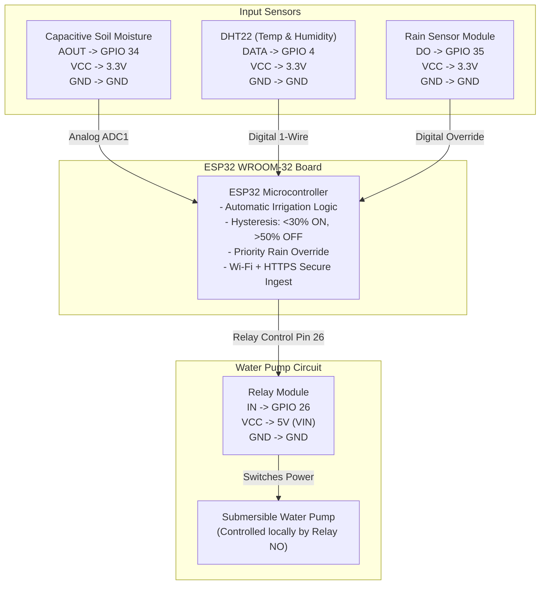

# HIRA AGRI – ESP32 HARDWARE WIRING & PINOUT GUIDE

This guide provides the complete, step-by-step connection instructions for your **ESP32 WROOM-32**, sensors, and relay module.

---

## 1. GPIO Pin Assignment Summary Table

| Hardware Component | Component Pin | ESP32 GPIO Pin | Wire Type | Voltage Requirement | Description |
| :--- | :--- | :--- | :--- | :--- | :--- |
| **Capacitive Moisture Sensor v1.2/v2.0** | `AOUT` / `SIG` | **GPIO 34** (ADC1_CH6) | Analog In | 3.3V or 5V | Analog voltage output proportional to soil dielectric permittivity |
| | `VCC` | **3V3** or **VIN (5V)** | Power | 3.3V recommended for ADC linearity | Sensor power |
| | `GND` | **GND** | Ground | 0V | Common system ground |
| **DHT22 Temperature & Humidity** | `DATA` / `OUT` | **GPIO 4** | Digital I/O | 3.3V or 5V | Single-bus bidirectional digital signal (Use 4.7kΩ-10kΩ pull-up to VCC if bare sensor) |
| | `VCC` | **3V3** | Power | 3.3V - 5V | Sensor power |
| | `GND` | **GND** | Ground | 0V | Common system ground |
| **Rain Detection Sensor Board** | `DO` (Digital Out) | **GPIO 35** | Digital In | 3.3V or 5V | Digital comparator output: `LOW` = Rain drops detected, `HIGH` = Dry |
| | `AO` (Analog Out) | **GPIO 32** | Analog In | 3.3V or 5V | Optional analog rain depth measurement |
| | `VCC` | **3V3** or **VIN** | Power | 3.3V - 5V | Sensor power |
| | `GND` | **GND** | Ground | 0V | Common ground |
| **Water Pump Relay Module** | `IN` (Signal) | **GPIO 26** | Digital Out | 3.3V logic compatible | Drives the optocoupler transistor to switch pump relay |
| | `VCC` | **VIN (5V)** | Power | 5V | Relay coil driving power (requires 5V to actuate coil reliably) |
| | `GND` | **GND** | Ground | 0V | Common ground |
| **On-board Status LED** | Internal | **GPIO 2** | Digital Out | Built-in | Blinks on Wi-Fi connection, solid when connected |

> [!IMPORTANT]
> **Why GPIO 34, 35, 32?**
> The ESP32 contains two Analog-to-Digital Converters (ADC1 and ADC2). When Wi-Fi is actively transmitting data, **ADC2 is permanently disabled** by the ESP32 Wi-Fi driver. Therefore, analog sensors **MUST** be connected to **ADC1 pins** (GPIO 32, 33, 34, 35, 36, 39). Connecting soil moisture to ADC2 pins (like GPIO 2, 4, 12, 13, 14, 15, 25, 26, 27) will cause readings to freeze or report 0 during Wi-Fi transmission! Our firmware correctly routes soil moisture to **GPIO 34 (ADC1)**.

---

## 2. Water Pump & Relay High-Power Circuit

The relay safely isolates the 3.3V microelectronics of the ESP32 from the high-current water pump.

```
       +-----------------------+
       |   PUMP POWER SUPPLY   |  (e.g., 12V DC or 5V DC Adapter)
       +-----------------------+
           | (+)            | (-)
           |                |
           v                |
       +-------+            |
       | RELAY | COM        |
       | MODULE|            |
       |       | NO         |
       +-------+            |
           |                |
           +---> (+)        |
               +------------+
               | WATER PUMP |
               +------------+
```

1. **Relay `COM` (Common)**: Connect to the positive (+) terminal of the external pump power supply (e.g. 12V or 5V).
2. **Relay `NO` (Normally Open)**: Connect to the positive (+) wire of the water pump.
3. **External Power Supply `GND / (-)`**: Connect directly to the negative (-) wire of the water pump.
4. **Safety Rule**: When the relay is unpowered or in the failsafe state, the circuit is open (`NO`), ensuring the pump never runs unattended.

---

## 3. Visual System Wiring Diagram



---

## 4. Beginner Step-by-Step Connection Instructions

1. **Step 1: Power Off Everything**  
   Disconnect the ESP32 from your computer's USB port before plugging any jumper wires into the breadboard.

2. **Step 2: Connect the Capacitive Soil Moisture Sensor**  
   - Black wire: Sensor `GND` to ESP32 `GND`.
   - Red wire: Sensor `VCC` to ESP32 `3V3`.
   - Yellow/Blue wire: Sensor `AOUT` to ESP32 `GPIO 34`.

3. **Step 3: Connect the DHT22 Sensor**  
   - Pin 1 (`VCC`): Connect to ESP32 `3V3`.
   - Pin 2 (`DATA`): Connect to ESP32 `GPIO 4`. (If using a bare 4-pin DHT22 without a PCB, place a 10kΩ resistor between Pin 1 and Pin 2).
   - Pin 3: Not connected.
   - Pin 4 (`GND`): Connect to ESP32 `GND`.

4. **Step 4: Connect the Rain Detector Module**  
   - Rain sensor small amplifier board `VCC` -> ESP32 `3V3`.
   - Rain sensor `GND` -> ESP32 `GND`.
   - Rain sensor `DO` (Digital Out) -> ESP32 `GPIO 35`.
   - Connect the 2-pin water drop collection plate to the amplifier board using the supplied ribbon wire.

5. **Step 5: Connect the Relay Module**  
   - Relay `GND` -> ESP32 `GND`.
   - Relay `VCC` -> ESP32 `VIN` (provides 5V from USB).
   - Relay `IN` -> ESP32 `GPIO 26`.

6. **Step 6: Connect Common Ground**  
   Ensure all sensor grounds and the relay ground share a common ground bus with the ESP32 `GND` pin.
